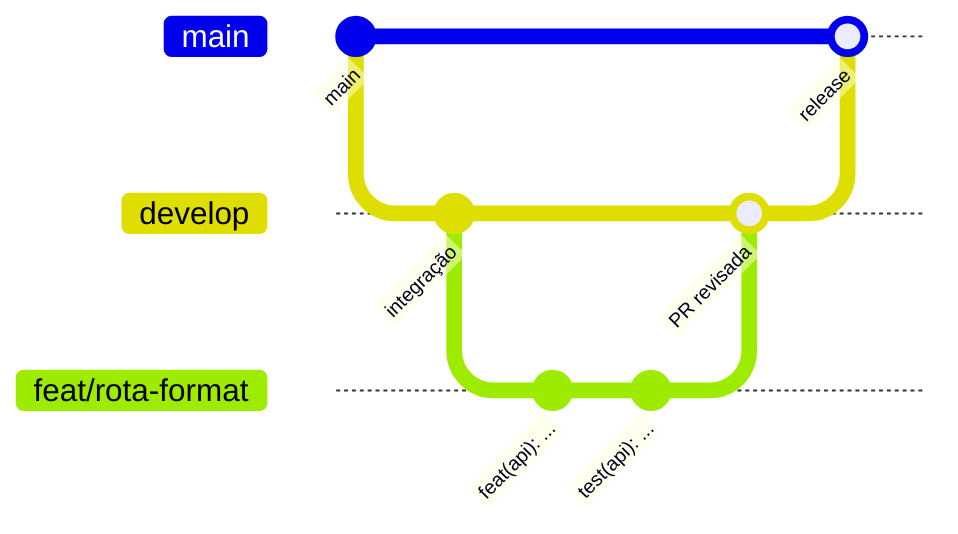

# Guia de contribuição

Obrigado por contribuir com o **Fala Clara**. Este guia resume o fluxo de trabalho do repositório.

## Fluxo de branches



1. Parta da `develop` atualizada.
2. Crie uma branch com prefixo do tipo: `feat/`, `fix/`, `chore/`, `docs/`, `refactor/`, `test/`, `style/` ou `ci/`.
3. Faça commits pequenos no padrão abaixo.
4. Abra a PR para a `develop` usando o template.
5. Após a revisão, o merge é feito por **squash**.
6. A `main` só recebe a PR de release, vinda da `develop`.

Nada vai direto para a `main` nem para a `develop`.

## Padrão de commits

[Conventional Commits](https://www.conventionalcommits.org/pt-br/v1.0.0/), em português e no imperativo:

```
<tipo>(<escopo>): <descrição>
```

| Tipo | Uso |
|---|---|
| `feat` | Nova funcionalidade |
| `fix` | Correção de bug |
| `docs` | Documentação |
| `style` | Formatação, sem mudar comportamento |
| `refactor` | Reestruturação sem mudar comportamento |
| `test` | Testes |
| `chore` | Configuração, dependências, manutenção |
| `ci` | Pipelines e workflows |
| `perf` | Desempenho |

Exemplos: `feat(api): adiciona rota /format`, `fix(web): corrige foco do botão de gravar`, `chore(repo): atualiza dependências`.

Mudanças que quebram compatibilidade usam `!` no tipo e `BREAKING CHANGE:` no rodapé.

## Antes de abrir a PR

- Rode lint e testes das áreas alteradas (`web/` e `api/`).
- Confira acessibilidade quando houver interface: navegação por teclado, foco visível e contraste.
- Não inclua segredos, `.env` nem textos ditados reais.
- Atualize a documentação em `docs/` quando a mudança afetar arquitetura, API ou privacidade.

## Issues

Use os modelos de **Bug**, **Funcionalidade** e **Tarefa técnica**. Informe a área (`web`, `api`, `docs`) e os critérios de aceite.

## Releases

A `main` representa as versões publicadas, com tags no padrão [SemVer](https://semver.org/lang/pt-BR/) (`v0.1.0`). Por enquanto a release é criada manualmente: PR da `develop` para a `main`, merge, tag e notas da release no GitHub.
