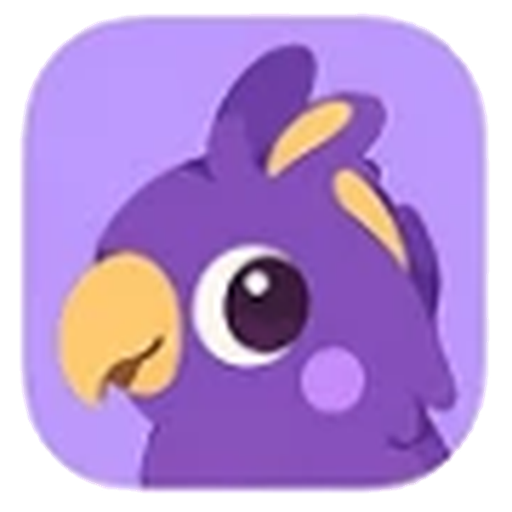
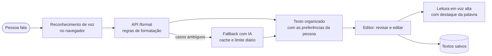
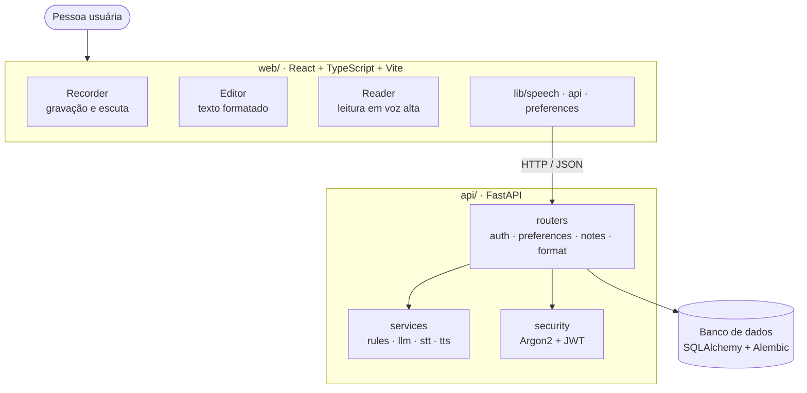
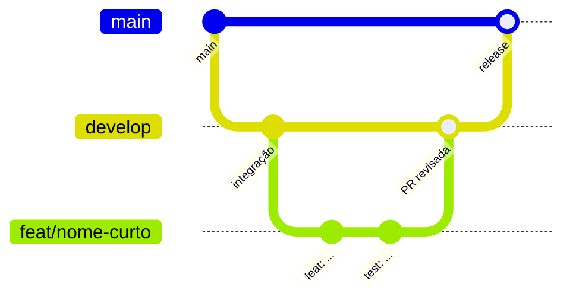
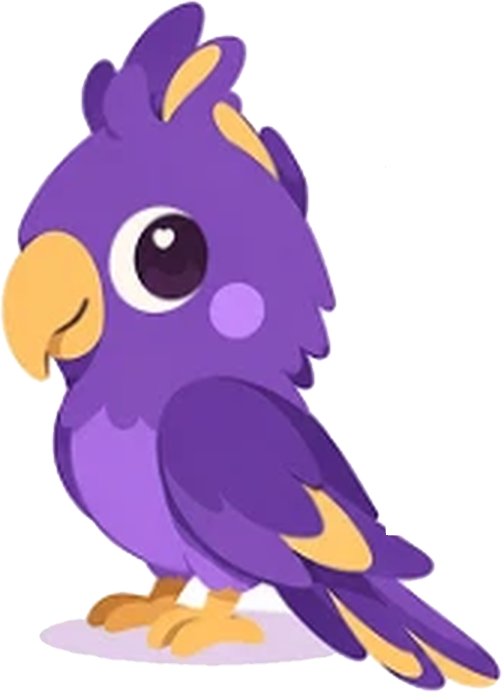

<a id="top"></a>

<div align="center">



# Fala Clara

**Ditado por voz acessível: fale e receba o texto organizado e formatado do seu jeito, com leitura em voz alta. Foco em TEA, dislexia e dificuldades de leitura e escrita.**

[](#roadmap)

[](https://react.dev/)
[](https://www.typescriptlang.org/)
[](https://vite.dev/)
[](https://tailwindcss.com/)
[](https://www.python.org/)
[](https://fastapi.tiangolo.com/)
[](https://docs.astral.sh/uv/)

[&style=flat-square&color=9A46D5)](https://github.com/ndelecrodev/fala-clara/commits/develop)
[](LICENSE)
[](https://github.com/ndelecrodev/fala-clara)

[Sobre](#sobre) ·
[Como funciona](#como-funciona) ·
[Arquitetura](#arquitetura) ·
[Estrutura](#estrutura-do-projeto) ·
[Roadmap](#roadmap) ·
[Contribuindo](#contribuindo)

</div>

---

## Sumário

- [Sobre](#sobre)
- [Como funciona](#como-funciona)
- [Acessibilidade](#acessibilidade)
- [Arquitetura](#arquitetura)
- [Tecnologias](#tecnologias)
- [Estrutura do projeto](#estrutura-do-projeto)
- [Roadmap](#roadmap)
- [Privacidade](#privacidade)
- [Contribuindo](#contribuindo)
- [Identidade visual](#identidade-visual)
- [Licença](#licença)

## Sobre

Escrever pode ser uma barreira para quem tem autismo (TEA), dislexia ou outras dificuldades de leitura e escrita. O **Fala Clara** inverte o caminho: a pessoa **fala**, e o texto volta organizado em parágrafos, com pontuação e na formatação que ela escolheu no cadastro (fonte, caixa, tema e espaçamento). O resultado também pode ser **lido em voz alta**, com destaque na palavra falada.

> [!NOTE]
> O projeto está em fase inicial. Este repositório reúne a configuração, a documentação e a base do monorepo; as funcionalidades entram por fases, conforme o [roadmap](#roadmap).

<p align="right"><a href="#top">voltar ao topo</a></p>

## Como funciona



1. **Cadastro e preferências:** a pessoa responde perguntas simples e o app aplica fonte, caixa, tema e espaçamento.
2. **Ditado:** um botão grande de gravar, com indicador claro de que está escutando.
3. **Formatação:** regras determinísticas classificam e organizam o texto; a IA entra só como alternativa.
4. **Revisão:** a pessoa edita o texto, ouve a leitura e salva.

<p align="right"><a href="#top">voltar ao topo</a></p>

## Acessibilidade

Acessibilidade é o requisito central, não um acabamento.

| Princípio | Como o projeto aplica |
|---|---|
| **Legibilidade** | Fontes pensadas para leitura (OpenDyslexic e Atkinson Hyperlegible), espaçamento e caixa ajustáveis |
| **Baixa carga cognitiva** | Telas simples, uma ação principal por vez, textos curtos |
| **Teclado e leitor de tela** | HTML semântico, foco visível e regras `jsx-a11y` no lint |
| **Contraste** | Meta WCAG 2.2 AA, sem informação transmitida só por cor |
| **Controle da pessoa** | Preferências persistidas e aplicadas em todo o app |

<p align="right"><a href="#top">voltar ao topo</a></p>

## Arquitetura



O detalhamento das decisões técnicas ficará em `docs/ARCHITECTURE.md`.

<p align="right"><a href="#top">voltar ao topo</a></p>

## Tecnologias

| Camada | Tecnologias |
|---|---|
| **Front-end** | React, TypeScript, Vite, Tailwind CSS, Vitest, ESLint com `jsx-a11y` |
| **Back-end** | Python, FastAPI, Pydantic, SQLAlchemy, Alembic, pytest, Ruff |
| **Segurança** | Hash de senha com Argon2 e autenticação por JWT |
| **Voz** | Web Speech API no navegador; `faster-whisper` e Piper previstos para a fase 2 |
| **Ferramentas** | `uv` (Python), `npm` (Node), GitHub Actions para lint e testes |

<p align="right"><a href="#top">voltar ao topo</a></p>

## Estrutura do projeto

Monorepo com duas aplicações independentes (`web/` e `api/`) e a documentação.

```
fala-clara/
├── web/        Front-end (React + TypeScript + Vite + Tailwind)
├── api/        Back-end (Python + FastAPI, gerenciado com uv)
├── docs/       Documentação do projeto
├── .github/    Templates de PR e issues, e workflows de CI
├── CLAUDE.md   Regras de trabalho para assistentes de código
├── LICENSE
└── README.md
```

A árvore detalhada de cada aplicação está em [`docs/ESTRUTURA_PASTAS.md`](docs/ESTRUTURA_PASTAS.md).

<p align="right"><a href="#top">voltar ao topo</a></p>

## Roadmap

- [x] Repositório, licença e documentação de estrutura
- [x] Fluxo de branches, templates de PR e de issues
- [ ] **Fase 1:** base do `api/` e do `web/`, cadastro com preferências, ditado com reconhecimento no navegador e formatação por regras
- [ ] **Fase 1:** editor, leitura em voz alta com destaque e textos salvos
- [ ] **Fase 2:** transcrição no servidor (`faster-whisper`) e voz sintética própria (Piper)
- [ ] Testes de acessibilidade com pessoas usuárias e checklist WCAG
- [ ] Publicação (deploy) e primeira release

O acompanhamento das tarefas é feito no ClickUp, no Space *Fala Clara*.

<p align="right"><a href="#top">voltar ao topo</a></p>

## Privacidade

O texto ditado pode conter dados pessoais e sensíveis. O projeto trata isso de acordo com a **LGPD**: coleta mínima, exclusão da conta e dos dados pela própria pessoa (`DELETE /account`) e nenhum texto ditado em logs. A política completa ficará em `docs/PRIVACIDADE.md`.

<p align="right"><a href="#top">voltar ao topo</a></p>

## Contribuindo



1. Parta sempre da `develop` atualizada e crie uma branch com prefixo do tipo: `feat/`, `fix/`, `chore/`, `docs/`, `refactor/`, `test/`.
2. Escreva os commits em português, no padrão [Conventional Commits](https://www.conventionalcommits.org/pt-br/v1.0.0/) e no imperativo, por exemplo `feat(api): adiciona rota /format`.
3. Abra a PR para a `develop` preenchendo o template. Nada vai direto para a `main`.
4. A `main` recebe apenas a PR de release, vinda da `develop`.

Os detalhes estão em [CONTRIBUTING.md](CONTRIBUTING.md).

<p align="right"><a href="#top">voltar ao topo</a></p>

## Identidade visual

<div align="center">



</div>

| Cor | Hex | Uso |
|---|---|---|
|  | `#9A46D5` | Roxo da marca |
|  | `#EEC05A` | Amarelo de destaque |
|  | `#D096D2` | Lilás de apoio |
|  | `#FFFBE5` | Fundo creme |

<p align="right"><a href="#top">voltar ao topo</a></p>

## Licença

Distribuído sob a licença Apache 2.0. Veja o arquivo [`LICENSE`](LICENSE).

<p align="right"><a href="#top">voltar ao topo</a></p>
